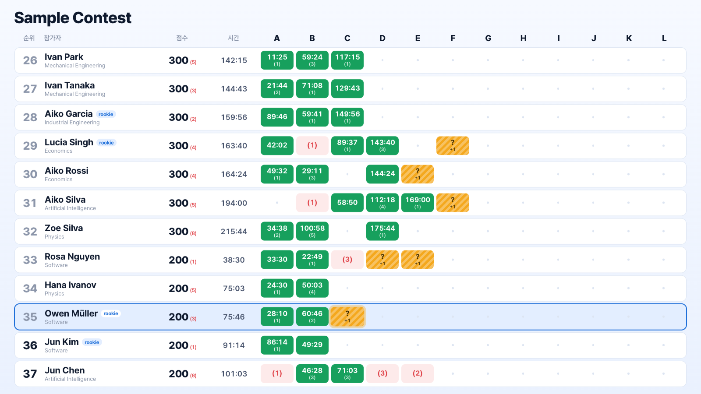
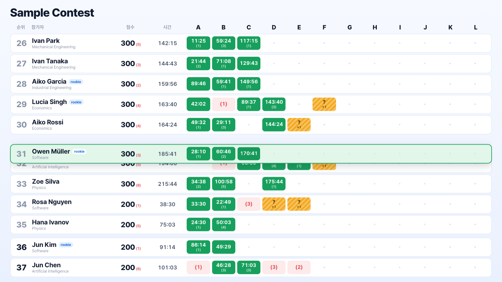

# AtCoder Resolver

A scoreboard resolver for contests hosted on [AtCoder](https://atcoder.jp). It takes a frozen scoreboard and reveals the hidden results one cell at a time, starting from the bottom of the board. When a hidden submission turns out to be accepted, that contestant's row climbs to its new place, the same way the ICPC Resolver and Spotboard do it at award ceremonies.

The output is a single self-contained HTML file. Open it on the presentation laptop and it runs offline. You don't need a server or network access.



> **Note:** The on-screen text and the collector's console messages are currently in Korean. The sample data is in English.

## Why this exists

AtCoder lets organizers freeze the scoreboard near the end of a contest, but it has no way to reveal the frozen part afterwards. Existing resolvers don't fit AtCoder contests well:

- [Spotboard](https://github.com/spotboard/spotboard) and the ICPC Resolver hard-code ICPC scoring: the sum of each problem's solve time plus 20 minutes per wrong attempt.
- AtCoder's default rule is different. The tie-breaker is the time of the *last* score-increasing submission plus 5 minutes per wrong attempt, and problems can have partial scores.

The two rules give different rankings for the same submissions. When we re-scored a real 49-contestant AtCoder contest under ICPC rules, 24 of the 45 contestants with a nonzero score ended up in a different place, including 6 of the top 10. So this project scores the board the way AtCoder does and only borrows the reveal procedure from ICPC.

## Features

- Supports both AtCoder tie-break rules: `last` (AtCoder default) and `sum` (ICPC style), with any penalty length.
- Handles partial scores. A reveal can raise a contestant's score without fully solving the problem.
- Collects data straight from AtCoder: the submission list, the contest page and the official standings JSON.
- Checks the collected data against AtCoder's own standings. Score, penalty count, time and rank are compared for every contestant, and so is the number of submissions per contestant. If a different rule setting would make them match, the collector says so.
- Award slides for rank-based prizes (`1st–3rd place`) and group prizes (for example the best two rookies who haven't won anything else). Ties at the cutoff share the prize.
- Presenter controls: keyboard and presentation-remote friendly, auto-play that stops on each award, step backwards, and resume after an accidental page reload.
- Hides every contestant's name, affiliation and group until the cursor first reaches them, like Spotboard's award mode. Handles are hidden too, since they identify people just as well.
- Shows the final rank on rows that are already settled, so a row labelled "2nd" never turns into "3rd" later.



## Quick start

You need Node.js 20 or newer and [pnpm](https://pnpm.io).

```sh
pnpm install
pnpm dev
```

Open the printed URL and choose the sample data button to walk through a fictional contest. Press `→` to advance one step.

To build the sample into a single file:

```sh
pnpm bundle data/sample.json   # writes dist/sample.html
```

## Running a ceremony

### 1. Write a config file

Copy `data/sample.config.json` to something like `data/my-contest.config.json` and edit it. See [Configuration](#configuration) below.

### 2. Give the collector your AtCoder session

While a contest is running or its scoreboard is frozen, only the organizer's account can see every submission. The collector needs that account's `REVEL_SESSION` cookie.

1. Log in to AtCoder with the organizer account.
2. Open the browser's developer tools and copy the value of the `REVEL_SESSION` cookie for `atcoder.jp`.
3. Save it to `.env` in the repository root. On macOS, with the value on the clipboard:

   ```sh
   printf "ATCODER_SESSION='%s'\n" "$(pbpaste)" > .env
   ```

   This keeps the value out of your terminal and shell history. An `ATCODER_SESSION` environment variable takes precedence over the file.

`.env` is listed in `.gitignore`. Treat the cookie as a password: anyone who has it is logged in as you.

### 3. Collect the data

```sh
pnpm collect data/my-contest.config.json
```

This writes the raw pages to `raw/<contestId>/` and the converted contest data to `data/my-contest.json`.

Every run downloads the whole submission list again, because a rejudge can change verdicts on any page. Pages hold 20 submissions and the collector waits one second between requests, so 300 submissions take about 15 seconds. Do a trial run during the contest to make sure the login and the config work.

| Option | Meaning |
| --- | --- |
| `--offline` | Don't contact AtCoder. Rebuild from the files already in `raw/<contestId>/`. Use this after editing only the participant list or the awards. |
| `--delay <ms>` | Wait between requests. Default `1000`. |
| `--out <path>` | Output path. Default: the config file name without `.config`. |

### 4. Read the two checks at the end

The collector finishes with two reports. Read both before the ceremony.

- **Submission counts.** For each contestant, the number of submissions collected is compared with the count in AtCoder's standings. A missing page or a duplicated submission shows up here.
- **Official standings.** The computed score, penalty count, time and rank are compared with AtCoder's standings for every contestant. Each mismatch is listed. If switching `rule` or `penaltyMinutes` would make everything match, the report says which setting to use. If AtCoder's standings are still frozen, the report says that it only compared up to the freeze.

### 5. Bundle a single file

```sh
pnpm bundle data/my-contest.json
```

This writes `dist/my-contest.html`, which contains both the app and the data. Copy it to the presentation machine and open it in a browser. Building again does not delete other files in `dist/`.


## Configuration

```json
{
  "contestId": "my-contest",
  "title": "My Contest",
  "rule": "last",
  "penaltyMinutes": 5,
  "freezeMinutesBeforeEnd": 30,
  "participants": "sample.participants.csv",
  "onlyListed": false,
  "exclude": ["staff_account_1"],
  "includeNoSubmission": false,
  "awards": [
    { "name": "1st Prize", "rank": [1, 1] },
    { "name": "2nd Prize", "rank": [2, 3] },
    { "name": "Rookie Award", "group": "rookie", "count": 2, "excludeAwarded": true }
  ]
}
```

| Field | Meaning |
| --- | --- |
| `contestId` | The contest's name in its AtCoder URL: `https://atcoder.jp/contests/{contestId}`. |
| `title` | Title shown on screen. Defaults to the title on AtCoder. |
| `rule` | `last` or `sum`. See [How ranking works](#how-ranking-works). Default `last`. |
| `penaltyMinutes` | Minutes added per wrong attempt. Defaults to the "Penalty" value on the contest page. |
| `freezeMinutesBeforeEnd` | Submissions made this many minutes before the end, or later, stay hidden until revealed. |
| `participants` | Path to the participant CSV, relative to the config file. Optional. |
| `onlyListed` | If `true`, only people in the participant list appear on the board. |
| `exclude` | AtCoder handles to leave off the board, such as staff and tester accounts. |
| `includeNoSubmission` | If `true`, people with no submissions appear on the board too. |
| `awards` | Prizes, applied from top to bottom. |

### Awards

There are two kinds of award rules.

- `{ "name": "2nd Prize", "rank": [2, 3] }` goes to everyone ranked 2nd through 3rd.
- `{ "name": "Rookie Award", "group": "rookie", "count": 2, "excludeAwarded": true }` goes to the top two contestants whose participant-list `group` is `rookie`, skipping anyone who already won an award listed above it.

Contestants tied at the cutoff all receive the award. Contestants with a score of zero never receive one. The data loader rejects malformed award rules with a message naming the bad field, so a typo can't make an award silently disappear.

### Participant list

A CSV file with a header row. `handle` is required. `name`, `affiliation` and `group` are optional. Handles are matched case-insensitively.

```csv
handle,name,affiliation,group
example_handle1,Alice Kim,Computer Science,
example_handle2,Bob Lee,Mathematics,rookie
```

The collector warns about listed handles with no submissions, submitters missing from the list, duplicate handles and handles in `exclude` that never appear. Most handle typos are caught this way.

## Keyboard controls

| Key | Action |
| --- | --- |
| `→` `Space` `Enter` `PageDown`, mouse click | Next step |
| `←` `Backspace` `PageUp` | Previous step |
| `A` | Toggle auto-play. Auto-play pauses on every award slide. |
| `F` | Toggle full screen |
| `+` `-` | Show fewer or more rows on screen |
| `Shift+Home` `Shift+End` | Jump to the start, or to the final standings |
| `Shift+R` | Resume where you left off last time (start screen only) |
| `?` or `H` | Help: controls and how to read a cell |
| `Esc` | Close help and stop auto-play |

Anything that could reveal results early requires `Shift`. Holding down the next-step key advances only one step. Letter keys use the physical key position, so they keep working when a non-Latin input method is active.

Most presentation remotes send `PageDown` and `PageUp`, so they work without setup. The current position is saved in the browser. After an accidental reload, the start screen offers `Shift+R` to jump back. The app never resumes on its own, so a reload can't flash the results.

## How ranking works

A higher total score ranks first. Between equal scores, the smaller time ranks first. If the time is also equal, the contestants share the rank. Times are in seconds and are computed in one of two ways.

- `last` (AtCoder default): the time of the last submission that raised the total score, plus the penalty for each wrong attempt.
- `sum` (ICPC style): the sum of the solve times of all scored problems, plus the penalty for each wrong attempt. Contests using this rule usually say "sum of times of AC" in the announcement.

A wrong attempt counts only on a problem where the contestant scored, and only if it was made before that score. Compile errors never count.

### Sources

These were checked against AtCoder in November 2026.

- The [AtCoder rules page](https://atcoder.jp/contests/abc300/rules) gives the formula for `last` with two worked examples. It also states that compile errors and wrong attempts on unsolved problems don't count. Both examples are unit tests in `src/core/scoring.test.ts`.
- The script behind AtCoder's standings page compares the total score first and then the time, and nothing else. It displays `TotalResult.Elapsed` from the standings JSON directly, so that value already includes penalties.
- The `sum` rule was checked against the published final standings of an AtCoder-hosted ICPC-style contest. Feeding in the winner's per-problem solve times and wrong attempts reproduces the official score, penalty count and time exactly.

The rules page shows the same text for every contest. A contest configured for `sum` with a 20-minute penalty still shows `last` and 5 minutes there. Take the rule from the contest announcement and the penalty from the contest's top page. Then let the official standings check in `pnpm collect` confirm the setting.

### Partial scores

I couldn't find official documentation of how AtCoder counts wrong attempts on partial-score problems. The assumption here is that every non-AC submission made before the contestant's best score on that problem counts. Contests where every problem is all-or-nothing are unaffected.

## How the reveal works

The whole reveal sequence is computed up front by `buildTimeline` in `src/core/resolver.ts`. The UI only steps through the precomputed frames, which makes going backwards trivial and lets the algorithm be tested without a browser.

The algorithm follows the ICPC Resolver:

1. Start from the scoreboard at the freeze, with the cursor on the bottom row.
2. If the contestant at the cursor has hidden submissions, reveal the first such problem in problem order. If their score goes up, the row moves up and the contestant who was pushed down now sits at the cursor.
3. If the contestant at the cursor has nothing left to reveal, their place is final. Show their award if they won one, then move the cursor up one row.
4. Stop when the cursor passes the top row.

Revealing a hidden submission can only raise a score, so a row below the cursor never moves again once it is final.

## Data format

`pnpm collect` produces this JSON, and you can write it by hand for contests hosted elsewhere. The types are in `src/core/types.ts`.

```jsonc
{
  "contest": {
    "id": "my-contest",
    "title": "My Contest",
    "startTime": "2026-01-01T09:00:00+09:00", // optional, display only
    "durationSeconds": 10800,
    "freezeSeconds": 9000,   // submissions at or after this time are hidden
    "rule": "last",          // "last" or "sum"
    "penaltySeconds": 300
  },
  "problems": [{ "id": "my_contest_a", "label": "A", "title": "Problem title" }],
  "teams": [{ "id": "alice", "name": "Alice Kim", "affiliation": "CS", "group": "rookie" }],
  "submissions": [
    { "id": 1, "teamId": "alice", "problemId": "my_contest_a", "time": 754, "verdict": "AC", "score": 100 }
  ],
  "awards": [{ "name": "1st Prize", "rank": [1, 1] }]
}
```

All times are seconds from the contest start. `verdict` uses AtCoder's abbreviations (`AC`, `WA`, `TLE`, `RE`, `CE` and so on). If you open `dist/index.html` without embedded data, it asks you to pick a JSON file.

## What the collector requests

All requests go to `https://atcoder.jp` with the `User-Agent` header `atcoder-resolver`.

| Request | Purpose |
| --- | --- |
| `/contests/{id}` | Contest title, start time, duration, penalty and problem list |
| `/contests/{id}/submissions?orderBy=created&page=N` | Every submission. Follows the pager's Next link until the last page. |
| `/contests/{id}/standings/json` | Official standings, used only for the two checks. If it can't be fetched, the collector says why and skips the checks. |

The collector stops with an error if AtCoder shows a login page or anything other than a submission list, or if a submission row can't be parsed. It does not guess.

## What has been verified

The collector was run against a finished 49-contestant AtCoder contest with 923 submissions, 263 of them after the freeze. Every contestant's score, penalty count, time and rank matched AtCoder's standings JSON, and so did every contestant's submission count.

Still unverified:

- The pages for that run were fetched from inside a logged-in browser and converted with `--offline`. Parsing, conversion and both checks ran on real pages. The few lines that attach the cookie to a request from Node have not run against AtCoder yet.
- The data has not been collected from an organizer account while the scoreboard was frozen. Before a real ceremony, use a practice contest to check that hidden submissions appear in the submission list and whether the standings JSON counts them.
- It is unclear when AtCoder lifts the freeze after the contest ends. If it lifts before the ceremony, contestants can see the results on their phones. Check this with AtCoder in advance.

## Development

```sh
pnpm test        # unit tests (vitest)
pnpm typecheck   # tsc
pnpm build       # dist/index.html, without data
pnpm sample      # regenerate data/sample.json
```

`pnpm sample` uses a fixed seed. Set `SAMPLE_SEED` to try others, and `SAMPLE_DRY=1` to print a summary without writing the file.

```
src/core/       scoring, reveal timeline, data validation
src/ui/         React app
tools/          collect, bundle, sample
tools/atcoder/  page download, HTML parsing, conversion to contest data
data/           sample data and config examples
docs/           screenshots for this README
```

`raw/` and real contest data in `data/` contain contestants' information and are ignored by git.

## Acknowledgements

The reveal procedure follows the [ICPC Resolver](https://tools.icpc.global/resolver/) and [Spotboard](https://github.com/spotboard/spotboard).
